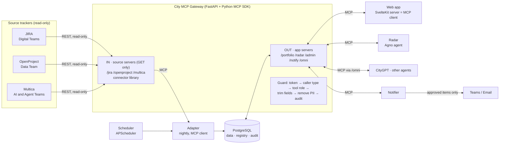

# Architecture

Version 3 · 19 Oct 2026 · MCP-first

Teams keep their own trackers. Everything lands in the **City MCP Gateway** first:
source data comes in through MCP, and the web app, Radar, other agents and the
Notifier read and act through MCP. Nothing else talks to the database or to the
trackers, so one guard and one audit log cover every request.

Visual version: https://claude.ai/artifact/WVoLwCrMid3dWXUqAa3T9K

## Principles

1. **MCP is the only way in or out.** The browser, Radar, CityGPT, the Notifier and the
   adapter all use the gateway. Only the gateway and the adapter connect to PostgreSQL.
   Source tokens live only inside the gateway.
2. **Read-only to the sources.** Source servers expose GET-based tools only. The connector
   library cannot send POST, PUT, PATCH or DELETE.
3. **Agents draft, people approve.** `decide_approval` accepts only a human caller with the
   Approver role. No agent token can call it.
4. **No project edits.** App servers write only our own state: chat, findings, drafts,
   settings. Never project data.
5. **Rules first, LLM second.** Health and data-quality checks are Python rules. The LLM writes
   summaries and answers only, with evidence.
6. **One audit log.** Every call from every caller is logged and kept 90 days.

## Components

| Component | Job | Notes |
| --- | --- | --- |
| Connector library | One class per source behind one interface: `list_projects()`, `get_project()`, `get_milestones()`, `get_sprints()`, `get_task_counts()`, `get_links()`, `get_risks()` | httpx, GET only. Mock connector reads `design/sample-data.json`. Tests use recorded responses |
| Source servers | `/jira/mcp`, `/openproject/mcp`, `/multica/mcp`: wrap the connector library as MCP tools | Callable by the adapter (service). Optional for human admins |
| Adapter | Calls the source servers, applies the prefix rule, maps fields and status, writes to DB, logs the run | One source failing must not stop the others |
| Scheduler | Daily sync 02:00; Radar check 02:10; Monday 09:00 stale check; Friday 16:00 digest | Times are admin settings (Asia/Yangon) |
| App servers | `/portfolio`, `/radar`, `/admin`, `/notify`, `/omni` (see table below) | The only way to read data or take an action |
| Guard | Runs on every call: verify token, decide caller type (human, agent, service), check tool role, run, trim fields, remove PII, write audit row | Rate limit per caller |
| Registry | Every server and tool: owner, version, description, roles, status | Postgres schema `mcp`. Tools start **off** until the owner turns them on. A changed description needs owner approval |
| Database | PostgreSQL. Portfolio data in schema `app`; registry and audit in schema `mcp` | Separate schema so the gateway can move to its own service later |
| Web app | Screens in `design/screens/` | SvelteKit server load functions call MCP with the user's SSO token. Results cached until the next sync |
| Radar | See `docs/radar-agent.md` | Agno agent, MCP client of `/portfolio` and `/radar` |
| Notifier | Sends approved digests, nudges and alerts to email / Teams | Uses `/notify` with a service token |

## Servers, tools and callers

| Server | Tools | Who may call |
| --- | --- | --- |
| `/jira/mcp` | `search_projects`, `get_versions`, `get_sprints`, `get_issue_counts`, `get_links` | service: adapter; human: admin (optional) |
| `/openproject/mcp` | `list_projects`, `get_work_packages`, `get_versions`, `get_relations` | service: adapter; human: admin (optional) |
| `/multica/mcp` | To define once the Multica API is known | service: adapter |
| `/portfolio/mcp` | `get_overview`, `list_projects`, `get_project`, `get_history`, `get_roadmap`, `get_dependencies`, `get_risks`, `get_sync_status` | human: viewer; agent |
| `/radar/mcp` | `get_conversation`, `post_message`, `get_findings`, `save_findings`, `create_draft`, `decide_approval`, `remember`, `forget` | human: chat, approver decides; agent: drafts only; service: Radar run |
| `/admin/mcp` | `list_sources`, `set_prefixes`, `set_schedule`, `run_sync`, `get_sync_log`, `get_non_compliant`, `set_tool_status` | human: admin |
| `/notify/mcp` | `list_approved`, `mark_sent`, `list_alerts` | service: Notifier |
| `/omni/mcp` | `discover_server`, `discover_tools`, `get_tool_schema`, `invoke_tool` (with `_projection`) | agent: CityGPT, Claude, other City agents |

Every list tool accepts a `fields` list (projection) so answers stay small.

## Daily flow

Every step is an MCP call through the guard.

1. 02:00: Adapter calls the source servers and writes the results to the DB. A failed source
   keeps its last good data and is marked stale.
2. 02:10: Radar runs the rule checks and calls `save_findings`.
3. Radar (Agno) reads `/portfolio`, posts the morning message and calls `create_draft`.
4. The approver opens the web app and calls `decide_approval` from the page.
5. The Notifier calls `list_approved`, sends to Teams or email, then `mark_sent`.
6. Any time: people and agents ask questions; answers show source, project code and sync time.

## Stack

| Layer | Choice |
| --- | --- |
| MCP gateway | Official Python MCP SDK, Streamable HTTP, inside FastAPI |
| Connectors | httpx, GET only (JIRA REST v2/v3 + Agile API, OpenProject API v3) |
| Agent | Agno 2.5, as an MCP client |
| LLM | OpenAI-compatible client; endpoint to confirm (CityGPT, Azure OpenAI or Claude) |
| Database | PostgreSQL 16, SQLAlchemy 2, Alembic |
| Schedules | APScheduler |
| Web app | SvelteKit 2 + Svelte 5, Tailwind 4, ECharts, Lucide |
| Login | City SSO (Entra ID, OIDC), user token passed to the gateway |
| Tests | pytest, Playwright |
| Run | Docker Compose: `web`, `mcp`, `worker`, `db` |

This matches the stack of the team's other City repos (FastAPI, Agno, SvelteKit, Tailwind).

## Design references

- Uber, "Designing MCP Gateway" (1 Oct 2026): one way in, registry, tools off by default,
  human/agent/service callers, PII removal, Omni discovery tools, response projection.
  Left out for now: AutoCrawler, LLM-written tool descriptions, protocol translation,
  separate registry service, Code Mode CLI.
- open-instinct (MIT): guard before every tool call, approvals, audit of every action,
  tracker text treated as untrusted data.
- `omni-mcp-gateway` (no licence): read for design only. No code copied.

## Growing into a City-wide gateway

The gateway is built as plug-in server modules with its own `mcp` schema. When a second City
app wants to use it, move `backend/app/mcp/` to its own repo and service (`city-mcp-gateway`);
Portfolio Radar becomes one server among many.

## Risks

| Risk | Mitigation |
| --- | --- |
| Gateway down stops everything | Health and readiness checks, automatic restart; can run as more than one copy |
| Overview slower through MCP | One `get_overview` tool, field projection, cache until next sync |
| Prompt injection in tracker text | Tracker text passed to the LLM as data, never as instructions; agents cannot approve or send |
