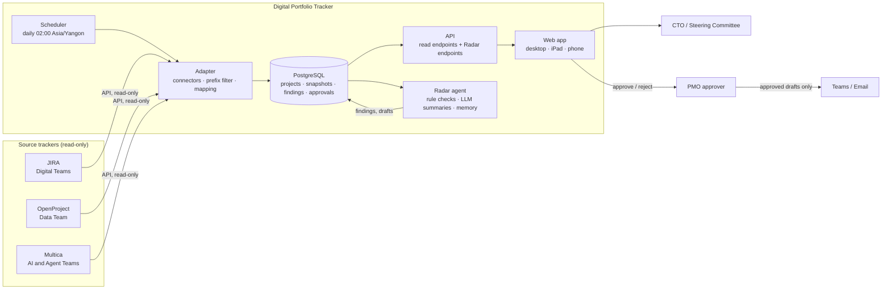

# Architecture

Teams keep their own trackers. The adapter reads them all, read-only, once a day.
Everything the app and Radar show comes from our own database.

## Components

| Component | Job | Notes |
| --- | --- | --- |
| Connectors | One per source, same interface: `listProjects()`, `getProject()`, `getMilestones()`, `getSprints()`, `getTaskCounts()`, `getLinks()`, `getRisks()` | Read-only tokens. Recorded responses for tests |
| Adapter | Run connectors, apply prefix rule, map fields and status, write to DB, log the run | One source failing must not stop others |
| Scheduler | Daily sync at 02:00; Radar check right after; Monday 09:00 stale check; Friday 16:00 digest | Times are admin settings |
| Database | Single source of truth for the app and Radar | See data model in PRD |
| API | Read endpoints for screens; Radar endpoints for conversation, approvals, memory | No write endpoints for project data |
| Web app | Screens in `design/screens/` | SSO; role checks for admin and approver |
| Radar | See `docs/radar-agent.md` | Rules in code; LLM for words only |
| Notifier | Sends approved digests, nudges and alerts to email / Teams | Sends only items with status `approved` |

## Daily flow

1. 02:00 — Scheduler starts the sync. Each connector reads its source. Results go to the DB. Failures keep last good data and mark the source stale.
2. ~02:10 — Radar runs the checks on every project, writes findings, updates its mood, and posts the morning message in each user's conversation.
3. Radar drafts nudges for off-track projects (if the approver said yes) and, on Fridays, the Steering Committee digest.
4. Approver opens Radar, answers questions, approves or rejects drafts. The Notifier sends approved items.
5. Any time — users ask Radar questions; Radar answers from the DB with evidence links.

## Security

- Source tokens in the secret store, read-only scope.
- SSO for every page and API; Entra ID groups for Admin and Approver.
- Radar's tools are read-only DB queries plus "create draft". Sending is done by the Notifier only after approval.
- All runs, findings, drafts and approvals are logged (90 days).
