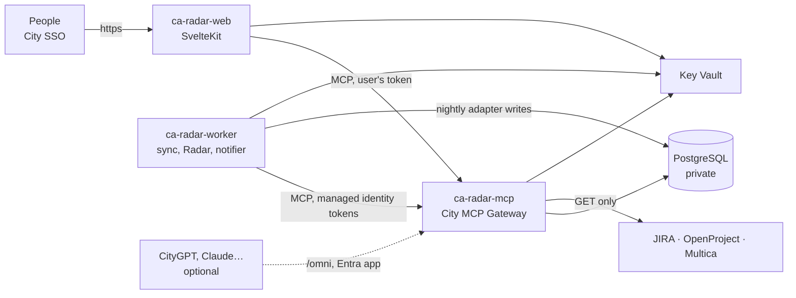

# Deploy on Azure

Everything runs in one resource group, built from `infra/main.bicep` by the GitHub Actions workflow
`.github/workflows/deploy.yml`. No password or key is kept in GitHub except two secrets the
template needs (the database admin password and the web app's client secret); both are copied into
Key Vault.



## What the template creates

| Resource | Name | Notes |
|---|---|---|
| Container Apps environment | `cae-radar` | In its own VNet subnet; logs to Log Analytics (90 days) |
| Gateway | `ca-radar-mcp` | Internal only by default. Runs migrations at start. One copy |
| Worker | `ca-radar-worker` | No ingress. Exactly one copy (it holds the nightly schedule) |
| Web app | `ca-radar-web` | Public HTTPS; optional IP allow-list. 1–3 copies |
| PostgreSQL Flexible Server 16 | `pg-radar-…` | Private (VNet only), TLS required, 14-day backups |
| Key Vault | `kv-radar-…` | RBAC, soft delete and purge protection. Holds `database-url`, the web client secret, and every token pasted in Admin |
| Container Registry | `acrradar…` | No admin user; apps pull with their identities |
| Managed identities | `id-radar-*` | One each for the gateway, worker and web, plus one per worker job |

Who may do what:

| Identity | Registry | Key Vault | Gateway caller |
|---|---|---|---|
| gateway | pull | read and write secrets (Admin saves tokens) | – |
| worker | pull | read secrets (LLM key, Teams webhook, SMTP password, database URL) | – |
| web | pull | read secrets (its client secret) | – |
| adapter, radar-job, radar, notifier | – | – | service `adapter`, service `radar-job`, agent `radar`, service `notifier` |

The four job identities only sign in to the gateway (`SERVICE_AUTH=managed_identity`,
`app/servicetokens.py`). The template passes their client IDs to the gateway as `ENTRA_APPS`, so each
job gets only its own role, as in development.

## Step 1: Entra app registrations (City IT)

**a. Gateway API: "City MCP Gateway"**

1. New registration, single tenant. No redirect URI.
2. *Expose an API*: Application ID URI `api://city-mcp-gateway`; add the scope `access`
   ("Use the portfolio as the signed-in user").
3. *Manifest*: set `"requestedAccessTokenVersion": 2` (older portal: `accessTokenAcceptedVersion`).
   With version 2 tokens the audience is the app's **client ID**.
4. *Token configuration*: add the groups claim (security groups), so roles can follow groups.
5. *App roles*: add a role `Service` (allowed member types: Applications). Used in step 5.

**b. Web app: "Portfolio Radar"**

1. New registration, single tenant. Redirect URI (Web): `https://<web address>/auth/callback`.
   The deployment prints the address as `webRedirectUri`; add it after the first deployment, or
   use your custom domain now.
2. *Certificates & secrets*: a new client secret. It goes into GitHub as `WEB_CLIENT_SECRET`.
3. *API permissions*: add *City MCP Gateway → access* (delegated) and grant admin consent.
4. *Token configuration*: add the groups claim.

**c. Groups.** Make (or pick) Entra groups for viewers, approvers and admins. Their object IDs go
into Admin → Connections → Sign-in after the first start (or `entraGroupRoles` in the parameter file).

## Step 2: Resource group and the GitHub sign-in

```bash
az group create -n rg-portfolio-radar -l southeastasia

# An identity for GitHub Actions, trusted only for this repository's "production" environment
az identity create -g rg-portfolio-radar -n id-github-deploy
az identity federated-credential create -g rg-portfolio-radar --identity-name id-github-deploy \
  -n github-production --issuer https://token.actions.githubusercontent.com \
  --subject repo:raahulgupta07/portfolio-radar:environment:production --audiences api://AzureADTokenExchange

# It creates resources and gives the apps their roles in this resource group only
principal=$(az identity show -g rg-portfolio-radar -n id-github-deploy --query principalId -o tsv)
rg=$(az group show -n rg-portfolio-radar --query id -o tsv)
az role assignment create --assignee-object-id "$principal" --assignee-principal-type ServicePrincipal \
  --role Contributor --scope "$rg"
az role assignment create --assignee-object-id "$principal" --assignee-principal-type ServicePrincipal \
  --role "Role Based Access Control Administrator" --scope "$rg"
```

## Step 3: GitHub settings

In the repository: *Settings → Environments → New environment* `production` (add required
reviewers if you want a person to approve each deployment). Then add:

| Kind | Name | Value |
|---|---|---|
| Variable | `AZURE_CLIENT_ID` | client ID of `id-github-deploy` |
| Variable | `AZURE_TENANT_ID` | City tenant ID |
| Variable | `AZURE_SUBSCRIPTION_ID` | subscription ID |
| Variable | `AZURE_RESOURCE_GROUP` | `rg-portfolio-radar` |
| Variable | `ENTRA_TENANT_ID` | City tenant ID |
| Variable | `GATEWAY_AUDIENCE` | gateway API **client ID** (step 1a) |
| Variable | `GATEWAY_SCOPE` | `api://city-mcp-gateway/.default` |
| Variable | `WEB_CLIENT_ID` | web app client ID (step 1b) |
| Variable | `WEB_API_SCOPE` | `api://city-mcp-gateway/access` |
| Variable | `WEB_ORIGIN` | `https://portfolio.cityholdings.com.mm`, or empty for the Azure address |
| Variable | `TEAMS_BOT_APP_ID` | optional: the Radar bot app ID for Teams chat (docs/teams-bot.md) |
| Secret | `POSTGRES_ADMIN_PASSWORD` | a long random password (only Key Vault and the database see it) |
| Secret | `WEB_CLIENT_SECRET` | from step 1b |

The deploy workflow does nothing until `AZURE_RESOURCE_GROUP` is set.

## Step 4: Deploy

*Actions → Deploy to Azure → Run workflow* (later: every push to `main`). It:

1. creates or updates the registry, database, Key Vault and identities (`DEPLOY_APPS=false`);
2. builds both images inside the registry (`az acr build`, no Docker needed);
3. deploys the gateway, worker and web app on those images, tagged with the commit;
4. checks that the web app answers `/healthz`.

Every pull request also runs `.github/workflows/ci.yml`: backend tests on PostgreSQL, the web
type check and build, and a Bicep lint.

## Step 5: Let the worker jobs sign in

Give the four job identities (output `workerJobIdentities`) the gateway's `Service` role:

```bash
api_sp=$(az ad sp show --id <gateway API client ID> --query id -o tsv)
role=$(az ad sp show --id <gateway API client ID> --query "appRoles[?value=='Service'].id | [0]" -o tsv)
for mi in <adapter> <radarJob> <radar> <notifier>; do
  sp=$(az ad sp show --id "$mi" --query id -o tsv)
  az rest -m POST -u "https://graph.microsoft.com/v1.0/servicePrincipals/$sp/appRoleAssignments" \
    --body "{\"principalId\":\"$sp\",\"resourceId\":\"$api_sp\",\"appRoleId\":\"$role\"}"
done
```

## Step 6: First start

```bash
app=ca-radar-mcp; rg=rg-portfolio-radar
az containerapp exec -g $rg -n $app --command "python -m app.adapter seed"
# New tools start off. The owner turns them on (or later in Admin → MCP tools):
for s in portfolio radar notify admin omni system jira openproject; do
  az containerapp exec -g $rg -n $app --command "python -m app.mcp.cli on $s.* --by PortfolioOwner"
done
```

Then, signed in as an admin:

1. **Admin → Connections → Sign-in**: check the tenant and audience; map your groups to roles.
2. **Admin → Connections → JIRA / OpenProject**: address, service account, paste the read-only
   token (it goes straight to Key Vault), **Run the check**, then fill in and **confirm the field
   mapping**, then the status mapping. Turn Multica off until its connector exists.
3. **Admin → Connections → LLM, Teams, Email**: paste keys; each has a test button.
4. **Admin → Settings**: sync time (default 02:00 Asia/Yangon).

## Changes you may want

- **City agents (CityGPT, Claude) through `/omni`**: set `gatewayExternal = true`. The gateway then
  gets a public HTTPS address; every call still needs an Entra token from an agent registered in
  Admin → Agents. Put it behind Front Door with WAF if City policy asks for it.
- **Office-only access**: list City's public IP ranges in `webAllowedIps`.
- **Key Vault without public access**: add a private endpoint in the apps subnet and set
  `publicNetworkAccess: 'Disabled'`. The apps already reach it from inside the VNet.
- **Bigger database**: change `Standard_B2s` to a General Purpose SKU; the load test
  (`docs/load-test.md`) shows B2s is enough for 500 projects.

## Not done by the template

- A custom domain and its certificate (`az containerapp hostname add` and `bind`).
- Backups beyond PostgreSQL's 14-day point-in-time restore.
- Alerts. Suggested: worker container restarts, failed nightly syncs (Log Analytics query on
  `adapter.sync` warnings), and gateway 5xx.

The template compiles and passes `bicep lint` here; it has not been deployed to City's subscription yet.
