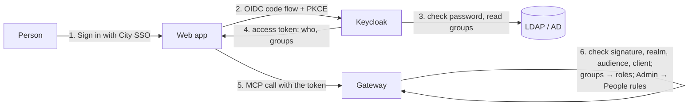

# Sign-in: City SSO, Keycloak, LDAP and Admin → People

Portfolio Radar has no passwords of its own. People sign in with City SSO, and the gateway checks
their token on every call. There are three ways, set in two places:

| Way | For | Where the password is checked |
|---|---|---|
| **Microsoft Entra ID** | City accounts in Microsoft 365 | Entra ID |
| **Keycloak** | City's own identity server | Keycloak, usually against **LDAP or Active Directory** (User Federation) |
| Sample users (`DEV_LOGIN=true`) | Development and demos only | none: pick a user. Off in production |



## Why LDAP goes through Keycloak

The app never sees a password. Keycloak checks it against LDAP, adds the person's LDAP groups to the
token, and the gateway turns groups into roles. A direct LDAP login inside the app would mean
handling passwords, issuing our own tokens and building lock-out, MFA and password policy again.
Keycloak already does all of that.

## Roles

| Role | Can |
|---|---|
| viewer | Read the portfolio, talk to Radar |
| approver | Also answer Radar's questions and approve or reject drafts |
| admin | Also everything in Admin |

Roles come from **groups**: Admin → Connections → City SSO → *Groups → roles*.
For Keycloak a group is its name or path (`portfolio-pmo`, `/portfolio-pmo`) or a realm role. LDAP
groups arrive through Keycloak's LDAP group mapper. The tick box "Everyone who signs in is a viewer"
decides whether people without a mapped group get in at all.

**Admin → People** handles exceptions, and every change applies on the person's next call:

- see everyone who signed in, their roles from groups, and their last sign-in;
- add a role for one person (for example, PMO cover for a month), with a note;
- add someone before their first sign-in;
- block a person. They are refused even with a valid SSO sign-in. You cannot block yourself.

## Set up Keycloak (City IT)

1. **Realm** (for example, `city`), reachable over https.
2. **User Federation → LDAP**: your LDAP or AD address, bind DN and credential, users DN; vendor
   "Active Directory" for AD. Edit mode READ_ONLY. Add a **group-ldap-mapper** (groups DN, group
   object class `groupOfNames` or `group` for AD).
3. **Client `portfolio-radar-web`**: OpenID Connect, client authentication on, standard flow only,
   PKCE S256. Valid redirect URI `https://<web address>/auth/callback`; post-logout redirect
   `https://<web address>/login`.
   - Mapper **Audience**: included custom audience `portfolio-radar-gateway` (in the access token).
   - Mapper **Group membership**: claim `groups`, full path off.
4. **Agents** that sign in as themselves (CityGPT, Claude): a confidential client with service
   accounts on, plus the same audience mapper; register its client ID in Admin → Agents.
5. **Web app container**: `OIDC_ISSUER=https://sso.city.local/realms/city`, `OIDC_CLIENT_ID`,
   `OIDC_CLIENT_SECRET`, optional `SSO_LABEL`; `DEV_LOGIN=false`.
6. **Admin → Connections → City SSO**: provider *Keycloak / LDAP*, realm address, audience
   `portfolio-radar-gateway`, sign-in app `portfolio-radar-web`, groups → roles, then **Check realm**.
   (Or set `SSO_PROVIDER=keycloak`, `OIDC_ISSUER`, `ENTRA_AUDIENCE`, `ENTRA_USER_APPS`,
   `ENTRA_GROUP_ROLES` on the gateway.)

`infra/sso-dev/realm-city.json` is a working example of all of this.

## What the gateway checks on a Keycloak token

Signature from the realm's published keys (RS256 only) · issuer equals the realm address · audience
contains the gateway's · not expired · a person's token comes from a listed sign-in client
(`azp`) · service-account tokens only for agents registered in Admin → Agents · groups and realm
roles → roles · Admin → People blocks and extra roles · in production the realm must use https.

## Try it on your computer

```bash
docker compose -f docker-compose.yml -f docker-compose.sso.yml up -d
docker compose exec mcp python -m app.adapter demo
```

Open http://localhost:3000 → **Sign in with City SSO**. Keycloak's page opens; its users come from the
sample LDAP directory (`infra/sso-dev/city.ldif`):

| User | Password | LDAP groups | Gets |
|---|---|---|---|
| `min` | `viewer-pass` | portfolio-viewers | viewer |
| `aye` | `approver-pass` | portfolio-viewers, portfolio-approvers | approver |
| `rahul` | `admin-pass` | portfolio-viewers, portfolio-admins | admin |

Keycloak admin console: http://localhost:8081 (admin / dev-keycloak-admin). These passwords are
for this local demo only.

Tested: `backend/tests/test_identity.py` (Keycloak tokens, groups, realm roles, wrong realm,
audience or client, service accounts, People rules, https in production) and
`web/e2e/sso.spec.ts` (real Keycloak + OpenLDAP: LDAP viewer signs in and cannot open Admin, wrong
password refused, admin blocks a person who is then refused).
