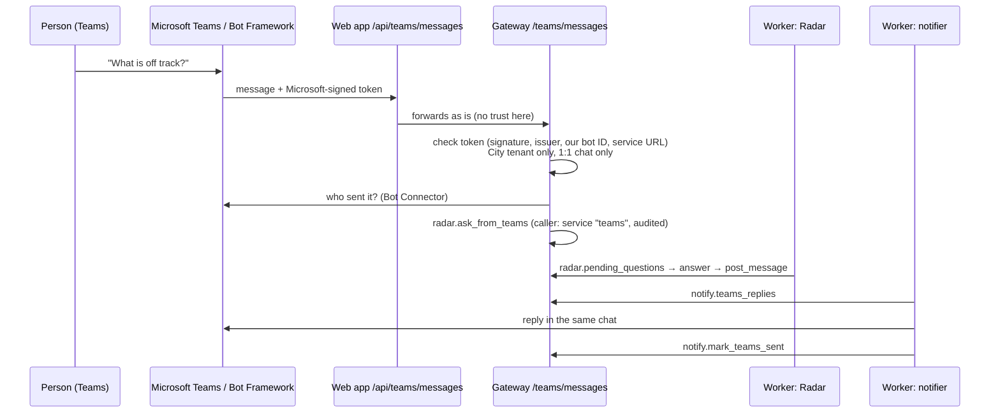

# Chat with Radar in Microsoft Teams

People open a 1:1 chat with **Radar** in Teams and ask the same questions as in the app
("What is off track?", "How is LOYAL02?"). The answer comes back in the chat within a few
seconds, with its evidence. The same question and answer also show in that person's chat in the app.

## Rules it keeps

- **MCP-first.** The bot reaches Radar only through `radar.ask_from_teams`, as the service
  caller `teams`, which may do nothing else (it cannot read the portfolio or answer approvals).
  Every message is a row in the audit log.
- **Radar never sends without approval.** Digests and messages to other people still wait for an
  approver. A chat answer goes only to the person who asked, in the same 1:1 chat, exactly like
  the chat in the app. Group chats and channels get a pointer to the 1:1 chat, never an answer.
- **No secrets in code.** The bot's client secret is pasted once in Admin → Connections → Teams
  and kept in the secret store.
- **Approvals stay in the app.** Teams can ask; "Radar asks" cards and draft approvals are answered
  in the app, where the person's roles come from City SSO.

## Security checks on every message

1. The Bot Framework token: RS256 signature from Microsoft's published keys, issuer
   `https://api.botframework.com`, audience = our bot app ID, not expired, and its `serviceurl`
   equal to the message's service URL.
2. The service URL must be Microsoft's Bot Connector (`smba.trafficmanager.net` or
   `*.botframework.com`, HTTPS, port 443), because our bot token is sent there.
3. The message's tenant must be City's tenant (Admin → Connections → Sign-in).
4. The sender's City account comes from the Bot Connector (`userPrincipalName`), and its Entra
   object ID must match the one in the signed message.
5. Body limit 256 KB; text limit 2,000 characters.

## Set it up (City IT, about 20 minutes)

1. **App registration** "Radar bot": single tenant, no redirect URI. Add a client secret.
2. **Azure Bot**: set the GitHub variable `TEAMS_BOT_APP_ID` to that app's client ID and deploy;
   the template creates the bot with its Teams channel and the messaging endpoint
   `https://<web address>/api/teams/messages` (output `teamsMessagingEndpoint`).
   Without the template: create an Azure Bot (single tenant, that app ID), set the messaging
   endpoint, and turn on the Microsoft Teams channel.
3. **Admin → Connections → Teams → Chat with Radar in Teams**: paste the bot app ID and its client
   secret, save, then **Test webhook and bot** (it signs in to the Bot Framework).
4. **Turn on the tools** in Admin → MCP tools: `radar.ask_from_teams`, `notify.teams_replies`,
   `notify.mark_teams_sent` (new tools start off).
5. **Teams app package**:
   `python teams/make_package.py --bot-app-id <id> --origin https://<web address>`, then
   Teams admin center → Manage apps → Upload, and allow it for City users (or pin it).

## Tested

`backend/tests/test_teams.py`: a question in Teams is answered in the same chat once; tokens for
another bot, another issuer or another service URL are refused; a service URL outside Microsoft is
refused; another tenant is refused; group chats get a pointer only; the welcome on install; and the
`teams` caller cannot read the portfolio or answer approvals. Microsoft's side is simulated; the
first real test needs City's bot registration.
